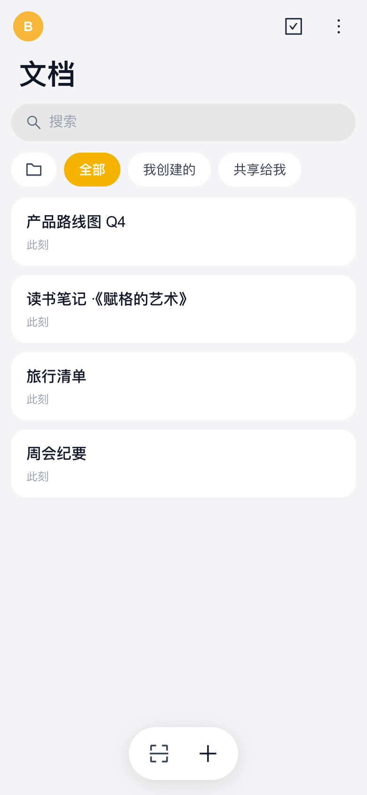

<div align="center">


# Polyphony

**Many voices. One score.**

Open-source, self-hostable real-time collaborative documents — open and write instantly, keep working offline, sync everywhere.

[](https://github.com/kkaaddff/polyphony/releases)
[](https://github.com/kkaaddff/polyphony/actions/workflows/build.yml)
[](LICENSE)
[](#-download-the-apps)
[](#-contributing)

[简体中文](README.md) · English

[Features](#-features) · [Quick start](#-quick-start) · [Offline & sync](#-offline--sync) · [Architecture](#-architecture) · [Development](#-development) · [Docs](docs/README.md) · [FAQ](#-faq)

</div>

> The name comes from Bach's fugues: several independent voices, no conductor, converging on one harmonious score — exactly what CRDT collaboration means: everyone edits freely, and the document always converges.


<table>
  <tr>
    <td align="center"><br /><sub>Mobile: document list</sub></td>
    <td align="center"><br /><sub>Mobile: read / edit</sub></td>
    <td align="center"><br /><sub>Offline: red tag, still editable</sub></td>
  </tr>
</table>

> Screenshots show the Chinese UI; switch to English in Settings (or let it follow your system language).

## ✨ Features

**Collaboration & editing**
- 🎼 **Real-time collaboration** — built on the [Yjs](https://github.com/yjs/yjs) CRDT: concurrent edits merge without conflicts; see who is online and from which client
- 📝 **Rich text** — headings, lists, to-dos, quotes, tables, code blocks, images, links; a native-feeling read/edit mode with a floating toolbar on mobile
- 🏷 **No naming required** — untitled documents are listed by the first words of their content

**Offline-first**
- 📶 **Open and edit without a connection** — every opened document is cached in IndexedDB, so opening never waits on the network; changes merge automatically when you reconnect
- 🔴 **Clear status** — a red "Offline" tag appears in the list and document header whenever the server is unreachable
- 👤 **Offline identity** — a cold start while offline still shows your last signed-in account and document list

**Accounts & sharing**
- 🔐 **Per-device credentials** — secrets are generated on the device and only their hash is stored server-side; revoke any device at any time
- 🗝 **Recovery key + QR pairing** — sign in on a new device by scanning a QR code (either direction), or restore with your recovery key
- 📱 **Scan to join** — document and pairing QR codes are plain web URLs, so any phone camera works
- 🗑 **Document lifecycle** — deleted documents go to a trash (30-day restore window); export to zip (text + images)

**Cross-platform, easy to self-host**
- 💻 **One codebase, five targets** — Web, macOS, Windows, Linux (Tauri 2) and Android
- 🐳 **Single container** — `docker compose up -d` serves the web app, API and collaboration WebSocket on one port, persisted in SQLite
- 🌐 **i18n** — English and Simplified Chinese

## 🚀 Quick start

### 1. Run the server (Docker)

```bash
git clone https://github.com/kkaaddff/polyphony.git
cd polyphony
docker compose up -d
```

Open `http://<server-ip>:9091` for the web app, or check health:

```bash
curl http://127.0.0.1:9091/health
# {"status":"ok","totalRooms":0,"totalUsers":0,"docs":0,...}
```

All data lives in named volumes: the SQLite database in `polyphony-data`, images in `polyphony-uploads`.

<details>
<summary><b>HTTPS / reverse proxy (Nginx, with WebSocket upgrade)</b></summary>

```nginx
server {
    listen 443 ssl;
    server_name docs.example.com;

    location / {
        proxy_pass http://127.0.0.1:9091;
        proxy_http_version 1.1;
        proxy_set_header Upgrade $http_upgrade;   # required for WebSocket
        proxy_set_header Connection "upgrade";
        proxy_set_header Host $host;
        client_max_body_size 6m;                  # 5 MB image limit + headroom
    }
}
```

</details>

### 2. 📥 Download the apps

Grab the latest build from [Releases](https://github.com/kkaaddff/polyphony/releases/latest):

| Platform | File | Notes |
|---|---|---|
| macOS (Apple Silicon) | `Polyphony_<version>_aarch64.dmg` | Not notarized — see the [FAQ](#-faq) |
| Windows | `Polyphony_<version>_x64-setup.exe` | SmartScreen will warn; choose "Run anyway" |
| Linux (Debian-based) | `Polyphony_<version>_amd64.deb` | `sudo apt install ./Polyphony_*.deb` |
| Android (arm64) | `app-universal-debug.apk` | Debug-signed, sideload directly |

### 3. Create an account

1. Open any client → **Create account**, enter a username and the server address (leave it empty when the web app is served by the same server);
2. **The recovery key is shown only once** — store it safely; it is the only way to recover your account on a new device;
3. To sign in elsewhere, choose "Sign in a new device" from the avatar menu on a signed-in device and scan the QR code;
4. To share a document, use "Share" in the document view — the other person scans the QR code and joins.

## 📶 Offline & sync

| Situation | Behavior |
|---|---|
| Server down / IP unreachable after a network change | A red "Offline" tag appears within ~4 s; account and list stay visible |
| Opening a document offline | Opens immediately from the local copy; fully editable |
| Edits made offline | Saved locally as you type; merged with the server and other people's edits on reconnect (CRDT) |
| Reconnecting | Probed every 5 s; the tag disappears, the list refreshes, collaboration reconnects |
| Creating a document offline | Not supported yet (codes are assigned by the server) — you get a clear message |

> Documents never opened on this device have no local copy and need a connection for the first sync.

## 🏗 Architecture

```
 Tauri desktop (dmg / nsis / deb)     tray recent docs · IndexedDB offline copy
 Tauri Android (arm64 apk)            scan to join · direct ws://IP:PORT
 Web (Vite SPA)                       same-origin by default, ?server= to override
        │  one shared client/src (platform differences live in platform/)
        ▼
 server/ Node — express + y-websocket (CRDT relay) + SQLite (node:sqlite) + multer (uploads)
        ▲
 all-in-one Docker: static web app + API + WS on a single port
```

**Stack:** React 19 · Vite · Tailwind CSS 4 · MDXEditor (Lexical) · Yjs · Tauri 2 · Node.js 22 · SQLite.
Design docs (identity, document lifecycle, collaboration internals, build & release, testing, decision log) are in [`docs/`](docs/README.md) (Chinese).

### Server environment variables

| Variable | Default | Description |
|---|---|---|
| `PORT` | `3001` (`9091` in the Docker image) | HTTP + WebSocket port |
| `STATIC_DIR` | `server/public` | Web app served on the same port |
| `DATA_DIR` | `server/data` | Directory of the SQLite database `polyphony.db` |
| `UPLOADS_DIR` | `server/uploads` | Image attachments (one folder per document) |

## 🛠 Development

Requires Node.js ≥ 22.5 (built-in `node:sqlite`).

```bash
./setup.sh          # npm install in client/ and server/
npm run dev:all     # web (Vite :5173) + server (:3001)
```

| Command | Purpose |
|---|---|
| `npm run dev:all` | Hot-reloading web app + server |
| `npm run dev:lan` | Build the web app and serve web + API + WS on one LAN address for phones, apps and desktops |
| `npm run lint` / `npm run build` | Type-check + ESLint / production build |
| `npm run android:build` | Local Android debug apk (`--install` to adb-install) |
| `cd client && npx tauri dev` | Desktop shell (requires Rust) |

### 🧪 Testing

```bash
npm --prefix server test                                    # server unit tests (node:test)
node server/convergence-smoke.mjs http://localhost:3001     # two-client convergence smoke (server running)
cd e2e && npx playwright test                               # end-to-end UI tests (system Chrome, local only)
```

## 🔒 Security notes

- **Two credentials**: the device credential is your identity (generated locally, stored hashed, revocable); the 8-character document code grants access to a document. Both are required.
- Direct connections use plain `ws://`; put an HTTPS reverse proxy in front for public deployments. WS credentials travel in the subprotocol header, never in URLs or access logs.
- Images are readable without auth (needed for inline display) behind 128-bit random paths, and only while the document is active.

Please report security issues privately to the maintainers rather than opening a public issue.

## ❓ FAQ

<details>
<summary><b>macOS says the app "is damaged and can't be opened"</b></summary>

The app is not notarized, so the browser quarantines it. After moving it to Applications, run:

```bash
xattr -rd com.apple.quarantine /Applications/Polyphony.app
```

</details>

<details>
<summary><b>Will I lose edits made offline?</b></summary>

No. Edits are written to IndexedDB as you type and merged when you reconnect. Note that signing out clears the local cache — reconnect first if you have unsynced changes.

</details>

## 🤝 Contributing

Issues and PRs are welcome. Please follow the conventions in [AGENTS.md](AGENTS.md) (TypeScript, two-space indent, platform-specific code only in `client/src/platform/`), keep commits small and imperative, include test evidence in PRs and screenshots for UI changes. [docs/decisions.md](docs/decisions.md) records many known pitfalls — worth a look before a larger change.

## 🙏 Acknowledgements

[Yjs](https://github.com/yjs/yjs) · [y-websocket](https://github.com/yjs/y-websocket) · [y-indexeddb](https://github.com/yjs/y-indexeddb) · [MDXEditor](https://github.com/mdx-editor/editor) · [Lexical](https://github.com/facebook/lexical) · [Tauri](https://github.com/tauri-apps/tauri) · [React](https://github.com/facebook/react) · [Vite](https://github.com/vitejs/vite) · [Tailwind CSS](https://github.com/tailwindlabs/tailwindcss)

## 📄 License

[MIT](LICENSE) © Polyphony Contributors · see [CHANGELOG.md](CHANGELOG.md) for release notes
