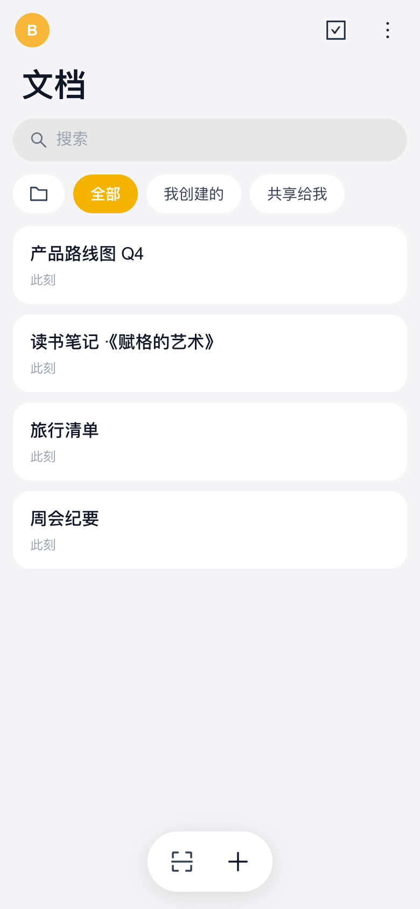

<div align="center">


# 复调 Polyphony

**Many voices. One score.**

开源、可自托管的实时协同文档 —— 打开即写,断网不慌,全平台同步

[](https://github.com/kkaaddff/polyphony/releases)
[](https://github.com/kkaaddff/polyphony/actions/workflows/build.yml)
[](LICENSE)
[](#-下载客户端)
[](#-参与贡献)

简体中文 · [English](README.en.md)

[特性](#-特性) · [快速开始](#-快速开始) · [离线与同步](#-离线与同步) · [架构](#-架构) · [开发](#-本地开发) · [文档](docs/README.md) · [常见问题](#-常见问题)

</div>

> 「复调」取自巴赫的赋格:多个独立声部各行其是、没有中央指挥,却收敛为一份和谐的总谱——这正是 CRDT 协同编辑的语义:每个人自由编辑,文档最终一致。


<table>
  <tr>
    <td align="center"><br /><sub>移动端:文档列表</sub></td>
    <td align="center"><br /><sub>移动端:阅读 / 编辑</sub></td>
    <td align="center"><br /><sub>离线:红色标签 + 本机可写</sub></td>
  </tr>
</table>

## ✨ 特性

**协同与编辑**
- 🎼 **实时协同** —— 基于 [Yjs](https://github.com/yjs/yjs) CRDT,多人并发编辑自动收敛、无冲突;在线用户与所在客户端实时可见
- 📝 **富文本** —— 标题、列表、待办、引用、表格、代码块、图片、链接;移动端是「阅读态 ↔ 编辑态」的原生化界面与悬浮工具栏
- 🏷 **免命名** —— 没起标题的文档,列表里自动用正文开头作标题

**离线优先**
- 📶 **断网照常打开与编辑** —— 文档内容缓存在本机 IndexedDB,打开不等网络;恢复连接后自动合并同步
- 🔴 **状态一目了然** —— 连不上服务器时列表与文档顶栏出现红色「离线」标签,点开说明与「检查服务器地址」入口
- 👤 **离线身份** —— 离线冷启动仍是上次登录的账号与文档列表,不会退化成匿名

**账号与分享**
- 🔐 **每设备独立凭据** —— 密钥在设备本地生成,服务端只存哈希;可随时吊销某台设备
- 🗝 **恢复密钥 + 扫码配对** —— 新设备扫码即登录(双向:老设备出码或新设备出码),也可用恢复密钥找回
- 📱 **扫码进文档** —— 文档 / 配对二维码都是普通 Web 链接,任何手机相机都能扫
- 🗑 **文档生命周期** —— 删除进回收站(30 天可恢复),一键导出 zip(正文 + 图片)

**全平台、易自托管**
- 💻 **一套代码五个端** —— Web、macOS、Windows、Linux(Tauri 2)、Android
- 🐳 **单容器部署** —— `docker compose up -d`,前端 + API + 协同 WebSocket 同一端口;SQLite 持久化,重启不丢
- 🌐 **多语言** —— 简体中文 / English,跟随系统或手动切换

## 🚀 快速开始

### 1. 部署服务器(Docker)

```bash
git clone https://github.com/kkaaddff/polyphony.git
cd polyphony
docker compose up -d
```

浏览器打开 `http://<服务器 IP>:9091` 即可使用 Web 版。验证:

```bash
curl http://127.0.0.1:9091/health
# {"status":"ok","totalRooms":0,"totalUsers":0,"docs":0,...}
```

数据全部落在命名卷里:SQLite 库(账号 / 文档快照 / 成员 / 附件登记)在 `polyphony-data`,图片在 `polyphony-uploads`。

<details>
<summary><b>HTTPS / 反向代理(Nginx 示例,含 WebSocket 升级)</b></summary>

裸 HTTP 直连 `http://IP:9091` 开箱即用;公网建议加一层 HTTPS 反代,关键是 WebSocket 升级头:

```nginx
server {
    listen 443 ssl;
    server_name docs.example.com;

    location / {
        proxy_pass http://127.0.0.1:9091;
        proxy_http_version 1.1;
        proxy_set_header Upgrade $http_upgrade;   # WebSocket 必需
        proxy_set_header Connection "upgrade";
        proxy_set_header Host $host;
        client_max_body_size 6m;                  # 图片上传 5MB 上限 + 头部余量
    }
}
```

</details>

### 2. 📥 下载客户端

到 [Releases](https://github.com/kkaaddff/polyphony/releases/latest) 下载对应平台:

| 平台 | 文件 | 备注 |
|---|---|---|
| macOS(Apple Silicon) | `Polyphony_<版本>_aarch64.dmg` | 未公证,首次打开见[常见问题](#-常见问题) |
| Windows | `Polyphony_<版本>_x64-setup.exe` | 会弹 SmartScreen,选「仍要运行」 |
| Linux(Debian 系) | `Polyphony_<版本>_amd64.deb` | `sudo apt install ./Polyphony_*.deb` |
| Android(arm64) | `app-universal-debug.apk` | debug 签名,直接侧载 |
| Web 静态包 | `web-dist.zip` | 一般无需单独下载,Docker 镜像已内置 |

### 3. 创建账号并开始写

1. 任意端打开应用 → **新建账号**,填用户名和服务器地址(Web 版同源打开时留空即可);
2. **恢复密钥仅展示这一次** —— 抄下来妥善保管,用于日后在新设备找回账号;
3. 其他设备登录:在已登录设备的头像菜单选「登录新设备」出二维码,新设备扫码确认即可;
4. 分享文档:文档页「分享」出二维码 / 链接,对方扫码直接进入。

> 进入文档需要两把钥匙:**设备凭据**(你是谁)+ **8 位文档码**(你能进哪篇)。

## 📶 离线与同步

复调按「本机优先」设计:每篇打开过的文档都在本机 IndexedDB 里有完整副本。

| 场景 | 表现 |
|---|---|
| 服务器宕机 / 换网后 IP 不可达 | 约 4 秒内出现红色「离线」标签;列表、账号照常显示 |
| 离线打开文档 | 立即打开(不等任何网络请求),本机内容可读可写 |
| 离线期间的修改 | 实时写入本机;恢复连接后自动与服务器及其他人的修改合并(CRDT,无冲突) |
| 恢复连接 | 后台每 5 秒探测一次,恢复后标签消失、列表刷新、协同通道自动重连 |
| 离线新建文档 | 暂不支持(文档码由服务端分配),会明确提示联网后重试 |

> 从没在本机打开过的文档,离线时没有本地副本,需要联网后首次同步。

## 🏗 架构

```
 Tauri 桌面 (dmg / nsis / deb)        托盘最近文档 · IndexedDB 离线副本
 Tauri Android (arm64 apk)            扫码进文档 · ws://IP:PORT 直连
 Web (Vite SPA)                       默认同源,?server= 可覆盖
        │  同一套 client/src(platform/ 收敛平台差异)
        ▼
 server/ Node —— express + y-websocket(CRDT 中继) + SQLite(node:sqlite) + multer(上传)
        ▲
 all-in-one Docker:同一端口托管静态前端 + API + WS,单容器自托管
```

- **每个文档 = 一个 Yjs 文档**:服务端防抖落盘到 SQLite,重启后自动恢复;客户端另持 IndexedDB 离线副本。
- **服务器地址运行时解析**(`client/src/lib/serverConfig.ts`):`?server=` 参数 > 本机已保存配置 > 开发环境变量 > 同源回退 —— 构建产物不内联任何地址。
- **二维码 = Web URL**(`<server>/join?code=…` 与 `/pair?code=…`):系统相机扫码落到 Web 版,App 内扫码直接解析。
- **技术栈**:React 19 · Vite · Tailwind CSS 4 · MDXEditor(Lexical) · Yjs · Tauri 2 · Node.js 22 · SQLite。

身份体系、文档生命周期、协同内核、构建发布、测试与踩坑记录等完整设计见 [`docs/`](docs/README.md)。

<details>
<summary><b>HTTP / WebSocket 接口摘要</b></summary>

| 接口 | 鉴权 | 说明 |
|---|---|---|
| `POST /auth/create` | 公开 | `{name, secret, platform}`(secret 本地生成)→ `{deviceId, name, recoveryKey}`;恢复密钥**仅此一次**返回 |
| `POST /auth/exchange` | 公开 | 恢复密钥 → 兑换本机设备凭据 |
| `/auth/pair/*` | 混合 | 配对双向状态机(create / request / claim / approve / poll / cancel) |
| `GET /rooms`、`POST /rooms/enter`、`POST /rooms/leave` | Bearer | 我的文档簿(含在线人数、`isOwner`、正文预览) |
| `POST /docs` | Bearer | 新建文档(服务端生成 8 位码,创建者即所有者) |
| `DELETE /docs/:code` 等 | Bearer | 回收站 / 恢复 / 彻底清除 / 一次性导出链接 |
| `POST /docs/:code/attachments` | Bearer | 图片上传;`GET /uploads/:code/:file` 免鉴权读取(路径含 128 位随机熵) |
| `GET /health` | 公开 | 只回数量(在线文档 / 人数 / 文档数 / 附件字节) |
| `ws(s)://…/<文档码>` | 子协议 `polyphony.v1, auth.<token>` | y-websocket 协同通道;关闭码 4001 凭据无效 / 4004 文档不存在 / 4010 已入回收站 |

</details>

### 服务端环境变量

| 变量 | 默认值 | 说明 |
|---|---|---|
| `PORT` | `3001`(Docker 镜像为 `9091`) | HTTP + WebSocket 监听端口 |
| `STATIC_DIR` | `server/public` | 同端口托管的 Web 前端目录 |
| `DATA_DIR` | `server/data` | SQLite 库 `polyphony.db` 所在目录 |
| `UPLOADS_DIR` | `server/uploads` | 图片附件目录(按文档码分子目录) |

## 🛠 本地开发

环境:Node.js ≥ 22.5(使用内置 `node:sqlite`)。

```bash
./setup.sh          # client/ 与 server/ 各自 npm install
npm run dev:all     # Web(Vite :5173)+ 服务端(:3001)
```

打开 <http://localhost:5173>。常用命令:

| 命令 | 作用 |
|---|---|
| `npm run dev:all` | 前端 + 服务端热开发 |
| `npm run dev:lan` | 构建 Web 后与 API / WS 同端口托管,打印局域网地址 —— 手机浏览器、App、桌面都用这一个地址联调 |
| `npm run lint` / `npm run build` | 类型检查 + ESLint / 生产构建(`client/dist/`) |
| `npm run android:build` | 本地构建 Android debug apk(加 `--install` 直接装到 adb 设备) |
| `cd client && npx tauri dev` | 桌面壳开发(需 Rust) |

桌面 / Android 的环境准备见 [docs/build-and-release.md](docs/build-and-release.md)。

### 🧪 测试

```bash
npm --prefix server test                                    # 服务端单测(node:test)
node server/convergence-smoke.mjs http://localhost:3001     # 双端收敛冒烟(先 npm run server)
cd e2e && npx playwright test                               # 端到端 UI 回归(系统 Chrome,仅本地)
```

- **收敛冒烟**:双客户端 100 次交错随机插入 + 删除轮 + 元数据 / 在线感知断言,外加鉴权、配对、生命周期、附件、导出门禁;改动协同模型或中继后必跑。
- **E2E**:桌面 + 移动(Pixel 7 仿真)两套视口,覆盖登录、文档、协同、离线、多语言等;刻意不接入 CI。

详见 [docs/testing.md](docs/testing.md)。

## 📦 发布与 CI

- **服务端 + Web**:任何能跑 Docker 的机器 `docker compose up -d`。仓库内 [`.gitea/workflows/deploy.yml`](.gitea/workflows/deploy.yml) 是自托管 CI 自动部署的参考(验证失败自动回滚)。
- **桌面 / Android**:推送 `v*` tag 触发 GitHub Actions([`build.yml`](.github/workflows/build.yml)),全部产物挂到 GitHub Release。

## 🔒 安全须知

- **双凭据模型**:设备凭据 = 账号身份(本地生成、服务端只存哈希、可吊销),文档码 = 文档准入,二者缺一不可。恢复密钥是唯一找回通道,仅在创建 / 重新生成时可见。
- 直连为明文 `ws://`;公网使用请套 HTTPS 反代。WS 凭据走子协议头,不出现在 URL 与访问日志中。
- 图片读取免鉴权(编辑器直链显示需要):路径含 128 位随机熵,且文档必须处于活跃状态。
- `/health` 只返回数量,不含任何文档码。

发现安全问题请先私下联系维护者,不要直接公开提 issue。

## ❓ 常见问题

<details>
<summary><b>macOS 提示「已损坏,无法打开」?</b></summary>

安装包未经 Apple 公证,浏览器下载后被打上隔离标记。拖入「应用程序」后执行一次:

```bash
xattr -rd com.apple.quarantine /Applications/Polyphony.app
```

</details>

<details>
<summary><b>手机 App 连不上服务器?</b></summary>

- 确认手机与服务器网络互通,地址带上协议和端口(如 `http://192.168.1.10:9091`);
- 开发联调时用 `npm run dev:lan` 打印的地址,Web / App / 桌面统一用它;
- 服务器地址变了(如电脑换了网络)在「设置」里改成新地址即可;连不上期间顶部会显示红色「离线」标签,本机照常可写。

</details>

<details>
<summary><b>离线写的内容会丢吗?</b></summary>

不会。修改实时写入本机 IndexedDB,恢复连接后自动合并到服务器。注意「退出登录」会清空本机缓存 —— 有未同步内容时请先联网。

</details>

<details>
<summary><b>v3 的数据能迁移到 v4 吗?</b></summary>

不能。v4 首次启动会把 v3 的 `accounts.json` / `uploads/` 归档到 `_v3-archive-<时间戳>/` 后以全新库启动。详见 [docs/identity-and-sharing.md](docs/identity-and-sharing.md)。

</details>

## 🤝 参与贡献

欢迎 Issue 和 PR!

1. Fork 后从 `main` 拉分支,遵循 [AGENTS.md](AGENTS.md) 中的代码风格(TypeScript、两空格缩进、平台差异只进 `client/src/platform/`);
2. 提交信息小而祈使(如 `fix: 离线时打开文档不再等待状态查询`);
3. PR 附上测试证据(跑过的命令与场景),UI 改动附截图;服务端新行为请补单测;
4. 动手前可以先翻 [docs/decisions.md](docs/decisions.md) —— 许多「看起来该这么改」的地方已经踩过坑。

## 🙏 致谢

- [Yjs](https://github.com/yjs/yjs) / [y-websocket](https://github.com/yjs/y-websocket) / [y-indexeddb](https://github.com/yjs/y-indexeddb) —— CRDT 协同内核
- [MDXEditor](https://github.com/mdx-editor/editor) / [Lexical](https://github.com/facebook/lexical) —— 富文本编辑器
- [Tauri](https://github.com/tauri-apps/tauri) —— 跨平台桌面 / 移动壳
- [React](https://github.com/facebook/react) / [Vite](https://github.com/vitejs/vite) / [Tailwind CSS](https://github.com/tailwindlabs/tailwindcss) / [Ant Design Icons](https://github.com/ant-design/ant-design-icons)

## 📄 许可证

[MIT](LICENSE) © Polyphony Contributors · 变更记录见 [CHANGELOG.md](CHANGELOG.md)
