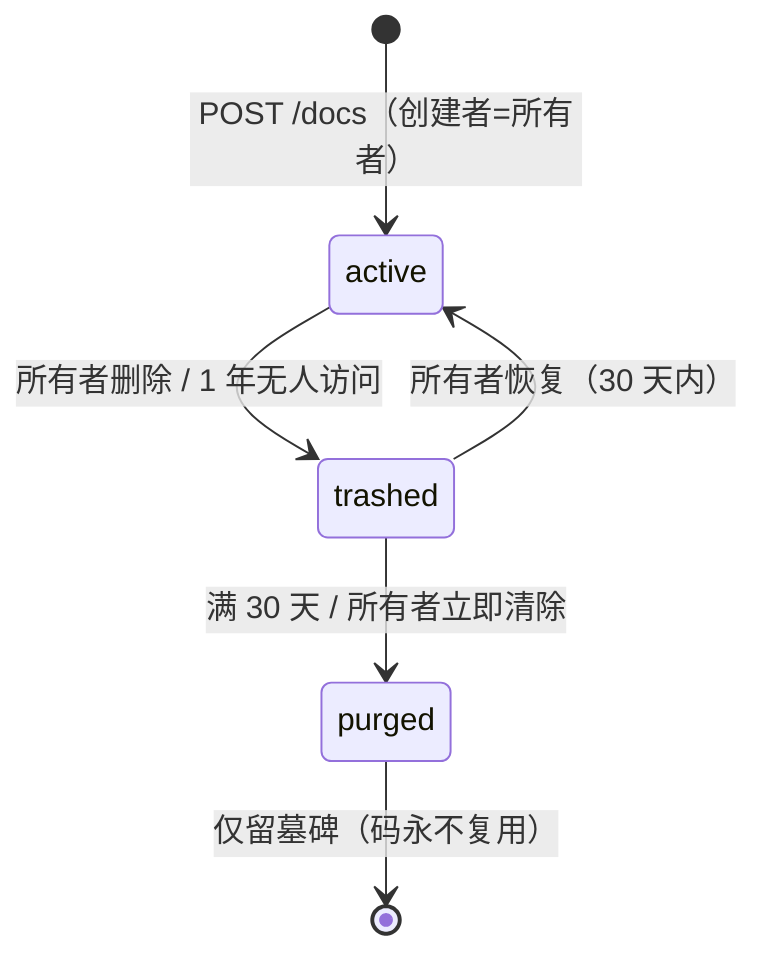

# 文档生命周期（v4.0）设计

状态：**设计已定稿，待实现**（2026-11-05，经两轮拷问 + 回读 + 两轮改进评审）
姊妹篇：`docs/identity-and-sharing.md`（同属 v4.0；本文的鉴权、设备会话、WS 子协议、**v4 全新开始**均以它为前提）
前置决策：ADR #14（内网/受信威胁模型）、#18（Docker all-in-one，`data`/`uploads` 两个卷）、#25（房间簿在服务端）；`docs/decisions.md` 后续路线「服务端文档持久化」条目由本文落地

> **v4 全新开始**：v3 的文档与图片在 v4 首次启动时随账号一起归档清空（姊妹篇 §6）。本文**不含任何存量文档 / 图片的迁移、认领或兼容逻辑**。
>
> **存储**：与姊妹篇共用单个 SQLite 文件 `data/polyphony.db`（§4.1）；图片文件仍在 `uploads` 卷。

---

## 1. 背景与目标

### 问题

用户原话：「补充设计一下：《文档生命周期》，需要包括文档及其附件（图片？）」

代码现状（§2）表明：**今天文档与附件的生命周期没有一个环节是设计出来的，全是副作用**——

1. **创建是隐式的**：进入任何一个码就凭空出现一篇空文档；手输错一位，用户会以为内容丢了。房间码由客户端 `Math.random()` 生成（非加密级）。
2. **持久化是偶然的**：文档只在服务端内存里（未接任何持久化）+ 各客户端 IndexedDB。服务器一重启，只有打开过它的设备的缓存里还有内容；从没打开过的新设备看到空文档。
3. **内存只增不减**：未接持久化时 y-websocket 在最后一人断开后**不释放**文档（`utils.js:203` 仅在有持久化时卸载），直到进程重启。
4. **删除不存在**：「退出房间」只是从我的列表移除；文档本身无人能删。
5. **附件与文档无关**：图片平铺在 `uploads/`，不知道属于哪篇文档；从文档删掉图片文件还在；文件名可猜（时间戳 + `Math.random`）且无鉴权公开访问。
6. **图片地址写死服务器**：文档里存的是带服务器地址的完整 URL；A 经内网 IP 上传的图，B 经公网域名打开即裂；服务器换地址全部裂图。
7. **活跃文档码被公开广播**：首页「在线房间」页签读取**无需登录**的 `/health`，列出服务器上所有正在被打开的文档码——任何能访问服务器的人都能拿到码，任何已登录用户都能进入别人正在编辑的文档。所有者、删除、回收站都建立在「只有知道码的人能进」之上，这个页签直接把码送了出去。

文档的终局一生应当是：**显式创建 → 协同编辑 → 可靠持久化 → 删除（可恢复）→ 彻底清除（连带附件、连带各设备缓存）**；附件从属于文档：随文档访问、随文档删除、不再被引用时经宽限期自动回收。

### 成功判据

- [ ] 只有「新建」才创建文档，创建者即所有者；进入不存在的码明确提示「文档不存在」。
- [ ] 文档内容在服务端可靠持久化：服务器重启后，任何设备（包括从未打开过的新设备）都能看到完整内容；无人在线的文档不占内存。
- [ ] 所有者可删除文档 → 进回收站，所有人立即无法进入、服务端对其图片立即返回 404（已缓存在查看者本机浏览器、最长 1 天的副本除外）；30 天内可恢复；到期（或所有者立即清除）后文档、附件彻底从磁盘删除，各设备缓存在下次接触时清除。
- [ ] 1 年无人访问的文档自动进回收站。
- [ ] 每张图片都登记在某篇文档名下；不再被任何文档引用超过 30 天的图片自动删除。
- [ ] 文档中的图片地址与服务器地址解耦：换访问地址 / 迁移服务器不裂图。
- [ ] 任何成员都能把文档导出为 zip（Markdown + 图片），Web 与 App 均可用。
- [ ] 退出房间 / 退出登录会清除本机对应缓存。
- [ ] 任何接口都不再公开列出文档码；首页无「在线房间」页签；`/health` 只回数量。
- [ ] 上传的图片不含 EXIF 等元数据（含 GPS 定位），长边不超过 2560px；手机原图不再因超过 5MB 被拒。
- [ ] 所有者自己的文档永远留在「我的房间」里，不会被列表上限挤掉。
- [ ] 文档的创建、删除、恢复、清除各自是一个原子操作，进程崩溃不留下半完成状态。

### 非目标

- **不做**版本历史（需关闭 Yjs GC，文档体积持续增长）、存储配额、转让所有权（均推迟）。
- **不做**图片以外的附件类型（机制按通用附件设计，扩展时只放开白名单）。
- **不做**文档级权限 / 成员管理（房间码仍是通行码；见 §10）。
- **不做**存量文档 / 图片的任何迁移（V4 全新开始）。
- **不改**文档内容模型（`Y.Text "document"` + `Y.Map "meta"`）。

---

## 2. 现状（相关模块）

| 位置 | 现状 | 本方案影响 |
|---|---|---|
| `client/src/lib/roomCode.ts:9` | 客户端 `Math.random()` 生成 8 位码 | 删除：改由服务端加密随机生成 |
| `client/src/pages/Home.tsx:142` | 「新建」= 本地生成码直接进入 | 改：先 `POST /docs` |
| `client/src/pages/Home.tsx:59-62,384-391` | 「在线房间」页签，读公开 `/health` 的房间列表 | **删除页签**；`/health` 仅作连通探测 |
| `server/index.js:283-297` `/health` | 公开返回全部活跃房间码与人数 | 改：只回 `totalRooms`、`totalUsers`、`docs`、`uploadsBytes` |
| `server/index.js:370-374` | `setupWSConnection(ws, req, { docName, gc: true })`，无持久化 | 改：`setPersistence` 接 SQLite 快照；连接前校验 `docs` 表 |
| `server/node_modules/y-websocket/bin/utils.js:145-152,203` | `bindState` 不被 await；仅有持久化时才卸载文档 | 依赖：同步读盘消除竞态；接持久化即解决内存泄漏 |
| `server/index.js:36` | `express.static('/uploads')` 无鉴权 | 改：自定义路由，校验文档状态 |
| `server/index.js:222-263` | multer 平铺存储，`image-<时间戳>-<随机>.ext`，`POST /upload` | 改：`POST /docs/:code/attachments`，存 `uploads/<码>/<128-bit>.ext`；**删除旧接口** |
| `client/src/pages/Editor.tsx:115-134` | 原图直接上传（含 EXIF/GPS，手机照片常超 5MB 被拒）；返回 `${baseUrl}${url}` 完整 URL 写进文档 | 改：上传前客户端重新编码（§4.8）；只写路径，显示时由 `imagePreviewHandler` 补全 |
| `client/src/lib/useCollaboration.ts:91-102` | `Y.Text "document"`、`Y.Map "meta"`；IndexedDB 库名 `polyphony-room-<码>` | 改：处理 4004/4010 关闭码并清缓存 |
| `server/auth.js:96-120` 房间簿 | `accounts.json` 内每账号 `rooms[]`，上限 50 挤掉最旧（会挤掉所有者自己的文档）；退出 = 解除书签 | 由 `memberships` 表取代（§4.1）；退出 = 删除 member 行，客户端额外清本机缓存 |
| `Dockerfile:50` / `docker-compose.yml:14` | `uploads`、`data` 两个卷 | 不变：数据库放 `data` 卷，图片放 `uploads` 卷 |
| `docs/deploy-and-ops.md:22` | 「所有客户端都关闭的房间在重启后为空」 | 本方案消除，文档同步更新 |

---

## 3. 方案总览

一句话：**服务端在 SQLite 中维护文档登记与内容快照；文档有所有者和状态机；附件登记在文档名下并按全局引用回收；图片地址只存路径；文档码不再被任何接口公开。**



| 状态 | 进入（WS） | 图片 | 所有者可做 | 其他成员看到 |
|---|---|---|---|---|
| active | ✓ | ✓ | 编辑、导出、删除 | 编辑、导出、退出 |
| trashed | ✗（4010） | 404 | 恢复、立即清除、导出 | 灰色「已被所有者删除」，可移除 |
| purged | ✗（4004） | 404 | — | 从列表消失 |
| （不存在） | ✗（4004） | 404 | — | 「文档不存在」 |

---

## 4. 详细设计

### 4.1 数据模型（SQLite：`data/polyphony.db`）

与姊妹篇 §4.2 共用同一数据库（`server/db.js`）。文档相关表：

```sql
CREATE TABLE docs (
  code           TEXT PRIMARY KEY,          -- 8 位 [A-Z0-9]
  owner_id       TEXT REFERENCES accounts(id) ON DELETE SET NULL, -- 墓碑在账号删除后可为 NULL
  name           TEXT NOT NULL DEFAULT '',  -- 写盘时由服务端从 Y.Map meta.roomName 同步
  status         TEXT NOT NULL,             -- active | trashed | purged
  trash_reason   TEXT,                      -- owner | inactive | account_deleted
  created_at     INTEGER NOT NULL,
  last_access_at INTEGER NOT NULL,          -- 最近一次 WS 连接
  trashed_at     INTEGER,
  purged_at      INTEGER,
  state          BLOB                       -- Y.encodeStateAsUpdate(doc)；purged 时为 NULL（墓碑）
);
CREATE TABLE memberships (                  -- 取代 v3 的账号房间簿 rooms[]
  account_id TEXT NOT NULL REFERENCES accounts(id) ON DELETE CASCADE,
  doc_code   TEXT NOT NULL REFERENCES docs(code),
  role       TEXT NOT NULL,                 -- owner | member
  last_used  INTEGER NOT NULL,
  PRIMARY KEY (account_id, doc_code)
);
CREATE TABLE attachments (
  key                TEXT PRIMARY KEY,      -- <码>/<32 hex>.<ext>
  doc_code           TEXT NOT NULL REFERENCES docs(code),
  size               INTEGER NOT NULL,
  uploader_id        TEXT,
  created_at         INTEGER NOT NULL,
  unreferenced_since INTEGER                -- NULL = 当前被至少一篇文档引用
);
CREATE TABLE doc_refs (                     -- 正文当前引用的附件（全局引用计数的来源）
  doc_code       TEXT NOT NULL,
  attachment_key TEXT NOT NULL,
  PRIMARY KEY (doc_code, attachment_key)
);
CREATE INDEX attachments_by_doc ON attachments(doc_code);
CREATE INDEX refs_by_attachment ON doc_refs(attachment_key);
```

- **成员关系**：「我的房间」= 本账号的 `memberships`。创建文档时写 `role='owner'`；他人进入时 upsert `role='member'`。`role='member'` 每账号上限 50 条，超出删 `last_used` 最旧者；**`role='owner'` 不计入上限、永不被挤掉**（修复 v3 房间簿会把所有者自己的文档挤出列表的缺陷）。
- **文档名**：不再由客户端上报（原 `/rooms/enter` 的 `name` 参数删除），服务端写盘时从 `meta.roomName` 同步到 `docs.name`。
- **附件文件**：`uploads/<码>/<32 hex>.<ext>`（文件系统；数据库只存登记）。
- 墓碑：`purged` 行保留 `code/status/purged_at`，其余列置 NULL，保证码永不复用。

### 4.2 持久化（`server/docStore.js`，新）

通过 `setPersistence({ bindState, writeState })` 接入 y-websocket：

- `bindState(code, ydoc)`：**同步**读取 `docs.state`（`node:sqlite` 为同步 API）并 `applyUpdate`——y-websocket 不 await `bindState`，同步读取消除「首个客户端先同步到空文档」的竞态；订阅 `update` → 防抖写库（静默 2s 触发，最长 10s 必写）。
- `writeState(code, ydoc)`：最后一人断开时立即写库；y-websocket 随后销毁文档、释放内存。
- 每次写库为**一个事务**：`UPDATE docs SET state, name`；扫描正文引用（§4.5）并与 `doc_refs` 求差，增删引用行、同步相关附件的 `unreferenced_since`。
- **停写标志**：每篇文档维护 `writable` 标志；purge 开始时先置 `false` 并取消待执行的防抖写入，此后 `writeState` 与防抖回调对该文档一律空操作——防止「清除后最后一个连接断开又把内容写回」（§4.6）。
- 进程收到 SIGTERM：同步刷写所有 `writable` 的脏文档后退出（容器重建不丢最近 10s）。

### 4.3 接口契约

鉴权均为姊妹篇的设备会话。「成员」= 任何已登录且知道码的账号（不变）。

| 方法 路径 | 鉴权 | 说明 | 错误 |
|---|---|---|---|
| `POST /docs` | 会话 | `{ name? }` → `201 { code }`。服务端 `crypto.randomInt` 生成 8 位 `[A-Z0-9]`，与 `docs` 表（含墓碑）去重；同一事务内插入 `docs` 与 `memberships(role='owner')` | — |
| `GET /docs/:code` | 会话 | `{ status: 'active'\|'trashed'\|'missing', isOwner, name }`（`purged` 与不存在均为 `missing`）；进入前检查用 | — |
| `DELETE /docs/:code` | 会话，**所有者** | active → trashed（reason=owner）；立即以 4010 关闭该文档全部 WS | 403 `E_NOT_OWNER`；409 `E_DOC_STATE` |
| `POST /docs/:code/restore` | 会话，所有者 | trashed → active | 403；409 |
| `POST /docs/:code/purge` | 会话，所有者 | trashed → purged（立即清除，§4.6） | 403；409 |
| `GET /docs/trash` | 会话 | 本账号为所有者的 trashed 文档：`[{ code, name, trashedAt, trashReason, purgeAt }]` | — |
| `POST /docs/:code/attachments` | 会话 | multipart `image`（jpg/jpeg/png/gif/webp，≤5MB，沿用）；文档须 active → `{ url: "/uploads/<码>/<32hex>.<ext>" }`。客户端已在上传前重新编码（§4.8），服务端校验规则不变。新附件 `unreferenced_since = now`（插入正文并写盘后才清零；上传后未插入的图片照常 30 天回收） | 404 `E_DOC_MISSING`；410 `E_DOC_TRASHED`；沿用 `E_FILE_*` |
| `GET /uploads/:code/:file` | 无 | 文档 active 且附件已登记 → 文件（`Cache-Control: private, max-age=86400`：只允许查看者本机缓存、最长 1 天）；否则 404 | 404 |
| `POST /docs/:code/export-link` | 会话 | active：任何成员；trashed：仅所有者 → `{ url, expiresAt }`，60s 内有效、一次性 | 403；404 |
| `GET /docs/:code/export?t=` | 一次性令牌 | zip 下载（§4.7）；令牌纯内存，用后即焚 | 410 `E_EXPORT_EXPIRED` |
| `GET /rooms`（改） | 会话 | 本账号 `memberships` ⨝ `docs`：`[{ code, name, lastUsed, userCount, status, isOwner }]`；purged 的成员关系在清除时已删 | — |
| `POST /rooms/enter`（改） | 会话 | `{ code }` → upsert `memberships(role='member')`（已是 owner 则只更新 `last_used`）；不再接收 `name` | 404 `E_DOC_MISSING` |
| `POST /rooms/leave`（不变语义） | 会话 | `{ codes }` → 删除本账号对这些文档的 **member** 行；owner 行不可通过 leave 删除（所有者用删除文档） | — |
| `GET /health`（改） | 无 | `{ status, timestamp, totalRooms, totalUsers, docs, uploadsBytes }`——**不含任何文档码**；`uploadsBytes = SUM(attachments.size)`，无需遍历目录 | — |

- `/docs/*` 响应 `Cache-Control: no-store`（附件文件除外）。
- **删除**：`express.static('/uploads')`、`POST /upload`。

### 4.4 WS 连接行为

在凭据校验（姊妹篇 §4.5）之后、`setupWSConnection` 之前：

1. 查 `docs` 表：不存在或 purged → `close(4004, 'doc missing')`；trashed → `close(4010, 'doc trashed')`。
2. `last_access_at = now`（内存更新，写库节流 1h）。
3. 继续 `setupWSConnection`。

服务端主动关闭：删除（4010）、清除（4004）时遍历该文档连接关闭。

### 4.5 附件引用与回收

**引用扫描**（每次写盘时对该文档正文执行）：

- 匹配 `/uploads/([A-Z0-9]{8})/([a-f0-9]{32}\.(?:jpe?g|png|gif|webp))`，忽略前面可能存在的协议与主机（用户手工粘贴的完整地址同样识别）。
- 结果与 `doc_refs` 中本文档的行求差，在写库事务内增删（§4.2）。

**回收规则**（附件 X 属于文档 D）：

- `doc_refs` 中引用 X 的行数为 0 → 若 `unreferenced_since` 为 NULL 则置为 now；大于 0 → 置回 NULL。
- **全局**判断：只要任何 active / trashed 文档引用 X 就不回收——保护被复制粘贴到其他文档的图片。
- `unreferenced_since` 超过 **30 天** → 删除登记与文件（宽限覆盖撤销操作与离线设备迟到的同步）。
- **例外**：D 被 purge 时，D 名下全部附件**无条件删除**；其他文档对它们的引用随之裂图（§9 L9）。

### 4.6 清扫任务

统一调度器 `server/sweeper.js`（1 小时，`unref()`，与姊妹篇的设备清扫、注销到期同一个定时器），文档部分依次：

1. active 且 `last_access_at` 超过 **365 天** → trashed（reason=inactive）。
2. trashed 且 `trashed_at` 超过 **30 天**（含 `account_deleted`）→ purge。
3. 未被引用超过 30 天的附件 → 删除。
4. **孤儿目录**：`uploads/<码>/` 对应的文档为 purged 或不存在 → 删除目录（兜底 purge 第 4 步之前崩溃的情况）。

**purge 动作（顺序固定）**：

1. 置 `writable = false`，取消待执行的防抖写入（§4.2）。
2. 以 4004 关闭该文档全部连接；y-websocket 随后卸载文档（其 `writeState` 已是空操作）。
3. **单个事务**：删除该文档的 `memberships`、`doc_refs`、`attachments` 行；`docs` 行降为墓碑（`state` 等置 NULL，`status='purged'`）。正文内容随事务提交从数据库消失。
4. 事务提交后删除 `uploads/<码>/` 目录；若此步前崩溃，调度器第 4 项兜底。

### 4.7 导出

- `GET /docs/:code/export?t=` 读取 `docs.state`（文档已加载则用内存态）：
  - `<文档名>.md`：正文中所有附件 URL（含可能的协议与主机前缀）改写为 `images/<文件名>`；文档名取 `meta.roomName`，空则用码；文件名清洗非法字符。
  - `images/<文件名>`：引用到且存在的文件；缺失的跳过。
  - 打包用 `fflate`（纯 JS、零原生依赖）；`Content-Disposition: attachment; filename="<ASCII 回落名>"; filename*=UTF-8''<百分号编码的文档名>.zip`（中文文档名不乱码）。
- 客户端：`POST export-link` 拿到 URL 后——
  - Web：`window.location.assign(url)` 触发下载。
  - App（桌面 / Android）：经 `platform/openExternal(url)` 在**系统浏览器**打开下载（App 内 WebView 无法直接保存文件）。新增 `tauri-plugin-opener`，capability 仅授予 `opener:allow-open-url`；按规矩 Tauri API 只在 `client/src/platform/` 引用。

### 4.8 客户端

- **`lib/docs.ts`（新）**：`createDoc`、`getDocStatus`、`deleteDoc`、`restoreDoc`、`purgeDoc`、`fetchTrash`、`exportDoc`。
- **新建**：`POST /docs` → 进编辑器。删除 `generateRoomCode`。
- **按码进入**（输入框、扫码、粘贴链接、`/join`）：先 `GET /docs/:code`——`missing` →「文档不存在」；`trashed` →「该文档已被所有者删除」；`active` → 进入。
- **首页**：删除「在线房间」页签（「我的房间」本就带每篇的在线人数）；`/health` 仅用于服务器连通状态点。
- **首页文档行**：所有者菜单「删除」（确认文案：「删除后所有成员立即无法访问，30 天内可在回收站恢复」）；成员「退出」。trashed 行灰显「已被所有者删除」+「移除」。
- **回收站**：头像菜单入口 → 列表（文档名、删除原因、剩余天数）→「恢复」「立即清除」（二次确认，不可撤销）「导出」。
- **编辑器顶栏菜单**：「导出」；所有者另有「删除」（确认后回首页）。
- **图片上传前处理**（`client/src/lib/imagePrep.ts`，新，三端通用、零依赖）：
  - GIF：原样上传（保留动画；仍受 5MB 限制）。
  - 其他（JPEG / PNG / WebP）：用 `` 解码（浏览器按 EXIF 方向自动摆正）→ 画到 canvas，长边超过 **2560px** 时等比缩小 → `canvas.toBlob` 重新编码：PNG 保持 PNG（截图类无损），若结果仍超 5MB 改为 WebP 0.9；JPEG → JPEG 0.85；WebP → WebP 0.85。重新编码天然丢弃全部元数据（EXIF / GPS / 设备型号）。
  - 处理失败（解码出错等）→ 提示「图片无法处理」，**不回退上传原图**（避免泄露元数据）。
- **图片显示**：上传走 `POST /docs/:code/attachments`，写入文档的是相对路径；`imagePlugin({ imagePreviewHandler })` 把以 `/uploads/` 开头的相对路径补全为 `getServerBase() + 路径` 显示。
- **缓存清理**：
  - `useCollaboration` 收到关闭码 4004/4010 → `IndexeddbPersistence.clearData()` → 回首页并 toast。
  - 退出房间 → 删除 `polyphony-room-<码>` 库。
  - 退出登录 → 删除全部 `polyphony-room-*` 库（`indexedDB.databases()` 可用时枚举；否则按「我的房间」与本地最近房间列表逐个删除）。

---

## 5. 边界与失败路径

| 场景 | 处理 |
|---|---|
| 服务器崩溃 | 最多丢最近 10s 服务端写入；在线/离线客户端的 IndexedDB 重连后 CRDT 补齐；SQLite（WAL）保证已提交事务完整 |
| `docs.state` 无法应用（数据异常） | 记错误日志、按空文档继续（客户端缓存补齐）；原 BLOB 复制到 `data/corrupt/<码>-<ts>.ystate` 保留 |
| purge 事务提交后、删目录前崩溃 | 正文已从数据库消失；图片目录由调度器孤儿目录清理兜底（期间附件路由已因文档 purged 返回 404） |
| 图片无法在客户端重新编码 | 提示失败，不上传原图 |
| 用户上传超大 GIF | 仍受 5MB 限制，提示压缩后再传 |
| purge 时文档正被编辑 / 有待写入 | 先停写再断开再删文件（§4.6）；快照不会被写回 |
| 删除时有人正在编辑 | 立即 4010 断开 → 清缓存 → 回首页 toast |
| 成员离线期间的修改，回来时文档已被删除 | 4010/4004 → 本机缓存直接清除，未同步修改丢失（§9 L21，评审提出的抢救方案未采纳） |
| 离线设备持有已删除文档的缓存 | 下次连接收到 4010/4004 即清缓存；服务端不接受其更新，内容不会复活 |
| 已清除的码被重新输入 | `missing`；墓碑保证码永不复用，旧缓存不会被导入新文档 |
| 图片被复制到另一篇文档后源文档被清除 | 目标文档中的图片裂开（§9 L9） |
| 上传时文档恰好进回收站 | 410 `E_DOC_TRASHED`，编辑器提示 |
| 导出令牌过期 / 重复使用 | 410；客户端重新申请 |
| 大量创建文档 | 不限（与账号创建一致，见 §10） |
| 1 年过期误伤低频文档 | 进回收站后所有者仍有 30 天恢复期；回收站列表标注「因长期未访问」 |

---

## 6. 上线

- **全新开始**：v3 平铺图片由姊妹篇 §6 的 `resetV3.js` 移入 `uploads/_v3-archive-<时间戳>/`；`data/polyphony.db` 由 `db.js` 新建。v3 客户端的本地文档缓存由姊妹篇 §4.6 的启动清理删除。
- **v3 客户端**：不兼容（凭据 401；无 `POST /upload`；不能新建文档），必须升级。
- **上线顺序**：与身份方案同一次切换（合入 `main` 即自动部署 + 推 `v4.0.0` tag 出安装包）。
- **回滚**：回退到 v3 镜像并恢复归档（姊妹篇 §6）；v4 期间的 `polyphony.db` 与 `uploads/<码>/` 对 v3 不可见，留在卷内不影响 v3。

---

## 7. 可观测性与测试

### 日志

- `[docs] create <码> owner=<name>` / `trash <码> reason=<owner|inactive>` / `restore` / `purge <码> attachments=<n>` / `export <码>`
- `[docs] sweep inactive=<n> purged=<n> attachments=<n>`
- `[docs] snapshot write failed <码>: <err>` / `snapshot corrupt <码>`
- 不记录文档正文、导出令牌。

### 验收清单

服务端单测（`node --test`，注入时钟与临时目录）：
- [ ] create：码 8 位 `[A-Z0-9]`、与墓碑去重；`docs` 与 owner 成员关系同一事务写入（注入异常时两者都不存在）
- [ ] 快照：写入 → 卸载 → 重新加载内容一致；防抖（2s/10s）；SIGTERM 刷写；异常 BLOB 另存并按空文档继续；`docs.name` 随 `meta.roomName` 同步
- [ ] **purge 竞态**：存在待执行防抖写入 + 在线连接时 purge → 连接关闭、卸载完成后 `docs.state` 为 NULL 且不会被写回
- [ ] purge 事务后、删目录前注入崩溃 → 下次调度孤儿目录被删除
- [ ] 成员关系：member 第 51 条挤掉最旧 member；owner 条目不计入上限、永不被挤掉；leave 不能删除 owner 行
- [ ] 状态机：非所有者删除 403；trashed 时 restore/purge；非法迁移 409
- [ ] 365 天不活跃 → trashed(inactive)；30 天 → purged
- [ ] purge：`state` 置 NULL、附件行与目录删除、成员关系删除；墓碑保留；码不复用
- [ ] 账号注销到期：其 `account_deleted` 文档与账号同日 purge（姊妹篇 §4.7）
- [ ] 引用扫描：相对路径与带主机前缀均识别；`doc_refs` 增删正确
- [ ] 回收：上传未插入的附件 30 天回收；仅被另一文档引用时不回收；无引用满 30 天回收；purge 无条件删除名下附件
- [ ] 附件路由：trashed/purged 文档 404；未登记文件 404；`/uploads` 根目录静态访问已移除
- [ ] 导出：zip 内 md 的图片路径已改写、`images/` 完整；中文文件名头正确；令牌一次性、60s 过期；trashed 仅所有者可导出
- [ ] `/health` 响应不含任何文档码

收敛冒烟（**必跑**，改动协同核心）：
- [ ] 显式 `POST /docs` 后双客户端 100 次交错插入 + 删除轮 + meta + awareness 通过
- [ ] 全员断开 → 文档被卸载 → 重启服务端 → 新客户端（无缓存）读到完整内容
- [ ] 不存在的码 4004；删除时在线连接收到 4010

E2E：
- [ ] 新建 → 编辑 → 刷新后内容在；输错码 →「文档不存在」
- [ ] 首页不再有「在线房间」页签
- [ ] 所有者删除 → 另一用户（独立 context）被踢回首页、列表灰显；回收站恢复后双方可再进入
- [ ] 立即清除 → 成员列表中消失
- [ ] 上传图片后文档中存的是相对路径；图片正常显示
- [ ] 上传带 EXIF（含 GPS）的 4000px JPEG → 服务端收到的文件无 EXIF、长边 2560px、方向正确；GIF 原样上传
- [ ] 导出 zip 可下载，含 md 与图片
- [ ] 退出房间后本机 `polyphony-room-<码>` 库被删除

手工（发版前）：
- [ ] 真机：App 内导出调起系统浏览器完成下载（桌面 + Android）
- [ ] 通过两个不同的服务器地址（内网 IP 与域名）访问同一文档，图片均正常

---

## 8. 分期与工作量

随 v4.0.0 一次发布。插入 `identity-and-sharing.md` §8 的实施顺序：

| 步 | 内容 | 验证 |
|---|---|---|
| 身份 1–3 | 重置、凭据模型、WS 子协议、配对 v2 | 见姊妹篇 |
| **L1** | `docStore.js`：`docs` / `memberships` 表 + 快照持久化（BLOB）+ 停写标志 + WS 关闭码；`/rooms` 改读成员关系 | 单测 + 冒烟 |
| **L2** | 文档接口（create/status/delete/restore/purge/trash）+ `/rooms` 附状态 + `/health` 只回数量 | 单测 |
| **L3** | 附件：新上传接口与存储布局、附件路由、引用扫描、回收、清扫任务；删除旧 `/upload` 与静态目录 | 单测 + 冒烟 |
| **L4** | 导出：一次性令牌 + `fflate` 打包；`tauri-plugin-opener` + `platform/openExternal` | 单测 + 手工 |
| 身份 4–5 + **L5** | 客户端：`lib/docs.ts`、新建/进入流程、删除「在线房间」页签、首页删除与回收站、编辑器菜单、`imagePrep.ts`（上传前重新编码）、`imagePreviewHandler`、缓存清理、i18n | e2e |
| 身份 6–7 + **L6** | 文档：本文状态、`deploy-and-ops.md`（重启不再清空、新增 `data/docs/`）、`architecture.md`、`decisions.md` 路线条目落地（含 `/health` 房间码暴露条目关闭）、ADR、CHANGELOG；全量验证 | §7 |

**明确推迟**：版本历史、存储配额、转让所有权、图片以外的附件类型、文档级权限。

---

## 9. 已定决策与被否方案

| # | 决定 | 理由 | 被否方案及理由 |
|---|---|---|---|
| L1 | 附件 v1 只做图片，机制按通用附件设计 | YAGNI；扩展只需放开白名单 | 图片 + 通用文件：需文件卡片插件、下载鉴权、重新定大小上限 |
| L2 | 创建者为所有者，只有所有者能删除 | 房间码是永久通行码，任何持码者能删即可清空他人文档 | 任何成员可删；不提供删除只靠过期（用户无法主动删除敏感内容） |
| L3 | 删除进回收站，30 天后彻底清除；所有者可立即清除 | 误删可恢复；需要时仍可立即抹除 | 立即彻底删除：误删不可恢复 |
| L4 | 显式创建；不存在的码报「文档不存在」 | 手误不再凭空产生空文档；所有者有明确来源 | 隐式创建（现状）：手误制造垃圾文档、所有者归属随机 |
| L5 | ~~旧文档由升级后第一个打开它的账号认领~~（**已作废**：V4 全新开始，无存量文档） | — | — |
| L6 | 1 年无人访问自动进回收站 | 控制磁盘增长（用户拍板） | 不自动过期：存储只能靠主动删除 |
| L7 | 内容快照作为 BLOB 存入 SQLite `docs.state`，2s/10s 防抖 + 断开即写 + 卸载（与姊妹篇 V23 同一数据库） | 写库与引用更新同一事务；purge 时正文随事务消失；备份一个文件；Node 内置 `node:sqlite` 零原生依赖；顺带解决内存泄漏（第二轮评审） | 每篇一个 `.ystate` 文件（上一版）：删除在事务之外、跨文件非原子；`y-leveldb`：原生模块在多架构 Docker 构建有风险、格式不透明 |
| L8 | `bindState` 同步读盘 | y-websocket 不 await `bindState`，异步读会让首个客户端先同步到空文档 | 异步读：竞态 |
| L9 | 回收按**全局**引用判断；但 purge 无条件删除名下附件 | 保护复制粘贴的图片不被日常回收误删；同时保证「删除文档 = 其图片真的消失」 | purge 时保留被他处引用的附件：被删文档的图片仍可公开访问，违背删除语义 |
| L10 | 附件读取无需登录，靠 128-bit 随机 ID + 文档状态校验；本机缓存最长 1 天 | `` 无法携带 Bearer；128-bit 远强于 8 位房间码；短缓存让删除后的残留可控 | Cookie 会话：引入第二套鉴权；签名 URL：显示路径每次变化，影响缓存与 CRDT 内容稳定；长期 immutable 缓存：删除后查看者本机可长期留存 |
| L11 | 文档内只存路径，显示时补全服务器地址 | 多地址访问、迁移服务器不裂图 | 存完整 URL（现状）：A 的地址对 B 不可达即裂 |
| L12 | 删除 / 清除时服务端以 4010 / 4004 关闭连接，客户端清缓存 | 离线设备不会让已删除内容复活 | 只靠 HTTP 检查：已打开的编辑器继续编辑、缓存残留 |
| L13 | 清除后保留墓碑，码永不复用 | 防止旧缓存被导入新文档 | 删记录：码可能被重新生成，旧设备缓存合并进新文档 |
| L14 | 导出 = 一次性 60s 令牌 + 服务端 `fflate` 打包；App 经系统浏览器下载（新增 opener 插件） | 三端同一路径；无需在 WebView 内实现文件保存 | 客户端打包：App 内仍无法保存文件；dialog+fs 插件：每平台各写一套保存逻辑 |
| L15 | ~~旧图片按需登记 + 迁移满 395 天一次性清理~~（**已作废**：V4 全新开始） | — | — |
| L16 | ~~旧文档从书签回填登记~~（**已作废**：V4 全新开始） | — | — |
| L17 | 退出房间清该文档缓存，退出登录清全部 | 退出即不再需要；登出后本机不留他人文档 | 保留缓存：设备丢失或转手时泄露 |
| L18 | 删除「在线房间」页签；`/health` 只回数量 | 公开列出活跃文档码，使所有者 / 删除 / 回收站形同虚设（用户拍板） | 改为登录可见：任何已登录用户仍能进入别人正在编辑的文档；维持现状（广场功能）：活跃文档对服务器上所有人公开 |
| L19 | purge 先停写、再断开、后删文件 | 否则「断开即写盘」与待执行防抖会把快照写回磁盘，正文残留（第一轮评审发现的设计缺陷） | 先删文件再断开（上一版）：快照复活 |
| L20 | ~~登记表只在结构性变化时落盘~~（**已作废**：L7 改用 SQLite 后不存在整份重写） | — | — |
| L21 | 文档被删时成员本机缓存直接清除 | 维持删除语义简单一致 | 「另存为新文档」抢救未同步修改（评审提出，未采纳） |
| L22 | 不活跃过期不设额外安全垫 | 维持 1 年 + 30 天回收站的统一规则 | 到期前 30 天提示「即将过期」+ 不活跃进回收站保留 90 天（评审提出，未采纳） |
| L23 | 「我的房间」与所有权合并为 `memberships` 表；owner 行不计入 50 上限、不可被 leave 删除 | 修复 v3 房间簿会把所有者自己的文档挤出列表、导致无法删除的缺陷（第二轮评审） | 维持账号内 `rooms[]` 数组 + 单独所有者字段：两处数据要同步，且需额外规则豁免所有者 |
| L24 | 上传前在客户端重新编码：去除全部元数据、长边 ≤2560px；GIF 原样；失败不回退原图 | 图片 URL 无需登录即可访问，手机照片的 GPS 等于公开拍摄地点；顺带解决手机原图超 5MB 被拒（第二轮评审） | 服务端处理：需 `sharp` 等原生模块；不处理：隐私泄露 + 上传失败 |
| L25 | 文档名由服务端从 `meta.roomName` 同步到 `docs.name` | 名字只有一个来源（Yjs），客户端不再单独上报 | 客户端经 `/rooms/enter` 上报（现状）：两个来源可能不一致 |
| L26 | 文档码维持 8 位 | 用户未采纳加长（第二轮评审提出 12 位） | 12 位 `XXXX-XXXX-XXXX`（约 62 bit）：见 §10 枚举风险 |

---

## 10. 遗留问题

| 问题 | 默认假设 / 处理 |
|---|---|
| 房间码仍是永久通行码，无法撤销某个成员的访问 | 本次不做；需文档级成员与权限模型，另立项（与身份方案 §10 同一条） |
| **文档码可被枚举**：8 位约 41 bit，`GET /docs/:code` 会回答存在与否，账号又可无限注册；估算服务器有 1000 篇文档时，每秒 1000 次尝试约 25 天可撞中一篇 | 维持 8 位（L26）；ADR #14 内网/受信威胁模型下可接受。若部署到公网：加长码（全新开始无兼容负担，随时可改）或在反代层对 `/docs/` 与 WS 连接限流 |
| 所有者账号永久不用，文档无人能删 | 1 年不活跃自动进回收站兜底；转让所有权推迟 |
| 磁盘被大量图片或文档写满 | 不设配额；单图 ≤5MB；`/health` 的 `docs`、`uploadsBytes` 便于监控 |
| 版本历史 | 推迟；需关闭 GC，另立项 |
| 回收站期间成员是否该收到通知 | 不做推送；列表灰显即通知 |
| 导出格式 | v1 仅 Markdown + 图片；PDF/HTML 推迟 |
